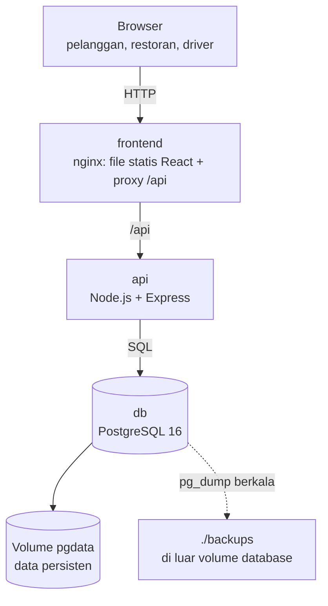
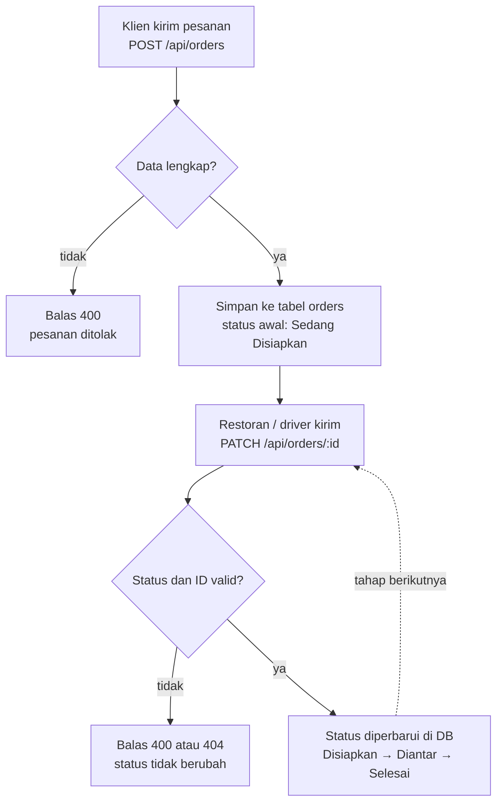

# Laporan Pertemuan 1 — Planning & Application Setup

**Kelompok 5** · Sistem Pemesanan Makanan (Food Delivery)

| Anggota | NIM |
|---|---|
| Arisula Buamona | 09020624025 |
| Ahmad Baihaqi Hasibullah | 09040624077 |
| Akhyan Sandy Afgara | 09040624079 |
| Rifki Subhan A. | 09040624095 |

**Fokus:** arsitektur awal, perancangan database, DRP awal, dan pembuatan aplikasi berbasis AI.

---

## 1. Studi Kasus dan Tantangan

Aplikasi pemesanan makanan yang dipakai pelanggan, restoran, dan driver secara bersamaan.

- **Tantangan:** skalabilitas multi-user dan konsistensi status pesanan (*Sedang Disiapkan → Diantar → Selesai*).
- **Fokus DRP:** pemulihan *state* transaksi agar operasional restoran dan driver tidak kacau jika sistem mati mendadak.
- **DR Test kelompok (Pertemuan 4):** hapus seluruh environment (App + DB) saat ada pesanan berstatus "Sedang Disiapkan", restore dari awal, lalu pastikan status pesanan tersebut kembali muncul dengan benar.

## 2. Rancangan Arsitektur



| Komponen | Teknologi | Peran |
|---|---|---|
| frontend | React 19, Vite, Tailwind, nginx | Antarmuka pesanan; nginx meneruskan `/api` ke backend |
| api | Node 22, Express, pg | REST API pesanan |
| db | PostgreSQL 16 | Penyimpanan tabel `orders` |

### Keputusan desain

- **Satu database sebagai sumber kebenaran status.** State tidak disimpan di memori aplikasi, sehingga aplikasi aman di-restart atau dibangun ulang.
- **Named volume `pgdata`** agar data bertahan walau container dihapus.
- **nginx sebagai reverse proxy** agar frontend memakai path relatif `/api` tanpa masalah CORS.
- **Healthcheck dan `depends_on`** agar API baru berjalan setelah database siap.

## 3. Rancangan Database

Tabel `orders`:

| Kolom | Tipe | Keterangan |
|---|---|---|
| `id` | UUID (PK) | `gen_random_uuid()` |
| `customer_name` | VARCHAR(100) | wajib diisi |
| `items` | JSONB | daftar item (`name`, `price`, `qty`) |
| `status` | VARCHAR(30) | `CHECK` hanya: Sedang Disiapkan, Diantar, Selesai |
| `created_at`, `updated_at` | TIMESTAMPTZ | otomatis `NOW()` |

Constraint `CHECK` pada `status` menjaga konsistensi status pesanan langsung di level database. Index `idx_orders_status` dibuat pada kolom `status`. Data dummy (4 pesanan, termasuk 2 berstatus "Sedang Disiapkan") disediakan di `backend/db/init.sql` untuk keperluan DR Test.

## 4. Endpoint API

| Method | Path | Fungsi |
|---|---|---|
| GET | `/api/health` | Cek API dan koneksi database |
| GET | `/api/orders` | Daftar pesanan |
| POST | `/api/orders` | Buat pesanan `{customerName, items[]}` |
| PATCH | `/api/orders/:id` | Ubah status pesanan |



## 5. Disaster Recovery Plan (DRP) Awal

**Aset kritis:** tabel `orders` di PostgreSQL. Aplikasi (frontend dan API) bersifat *stateless* dan dapat dibangun ulang dari Git.

| Metrik | Target | Alasan |
|---|---|---|
| **RTO** | ≤ 15 menit | Restoran dan driver tidak boleh lama kehilangan visibilitas pesanan aktif |
| **RPO** | ≤ 1 jam | Backup tiap 1 jam; pesanan dalam 1 jam terakhir dapat diinput ulang dari catatan restoran |

> Angka ini adalah usulan awal dan akan dibuktikan pada Pertemuan 4.

**Strategi backup:** `pg_dump` logis ke file `.sql` dari dalam container `db`, tiap 1 jam (cron/bash script, dibuat di Pertemuan 4), disimpan di *bind mount* `./backups` (di luar volume database), retensi 24 backup terakhir.

| Skenario bencana | Dampak | Respons |
|---|---|---|
| Container mati | Layanan down, data aman di volume | `docker compose up -d` |
| Seluruh environment (App + DB + volume) terhapus | Data hilang | Restore dari backup terbaru |
| Data korup atau salah hapus | Data salah | Restore dari backup sebelum kejadian |

**Prosedur restore (ringkas):**

1. Pastikan file backup terbaru ada di `./backups`.
2. Jalankan database dan tunggu status *healthy*.
3. Muat ulang data dari file `.sql` dengan `psql`.
4. Jalankan API dan frontend.
5. Validasi: pesanan berstatus "Sedang Disiapkan" muncul sesuai kondisi sebelum bencana, dan `/api/health` menjawab ok.
6. Catat waktu mulai dan selesai, lalu bandingkan dengan RTO.

## 6. Aplikasi Berjalan di Localhost

Prasyarat: Node.js dan PostgreSQL lokal dengan database `fooddelivery` (tabel dibuat dari `backend/db/init.sql`).

```bash
# Backend (port 3000)
cd tahu-tek-05/backend
npm install
npm start

# Frontend (Vite dev server; /api diteruskan ke localhost:3000)
cd tahu-tek-05/tahu-tek-05
npm install
npm run dev
```

**Bukti aplikasi berjalan:**

*[Tempel screenshot halaman aplikasi di localhost]*

*[Tempel screenshot hasil `http://localhost:3000/api/health` dan `http://localhost:3000/api/orders`]*

## 7. Penggunaan AI

Kode aplikasi (frontend, backend, dan skema database) dibuat dengan bantuan AI. Tim memahami dan bertanggung jawab atas kode yang dihasilkan.

**Prompt yang digunakan:**

1. Prompt backend dan skema database: *[tempel prompt asli]*
2. Prompt frontend: *[tempel prompt asli]*

## 8. Deliverables

- [x] Dokumen spesifikasi arsitektur (`docs/ARSITEKTUR.md`)
- [x] Dokumen DRP awal (`docs/DRP.md`)
- [x] Source code di repositori Git
- [ ] Screenshot aplikasi berjalan di localhost
- [ ] Prompt AI dilampirkan
